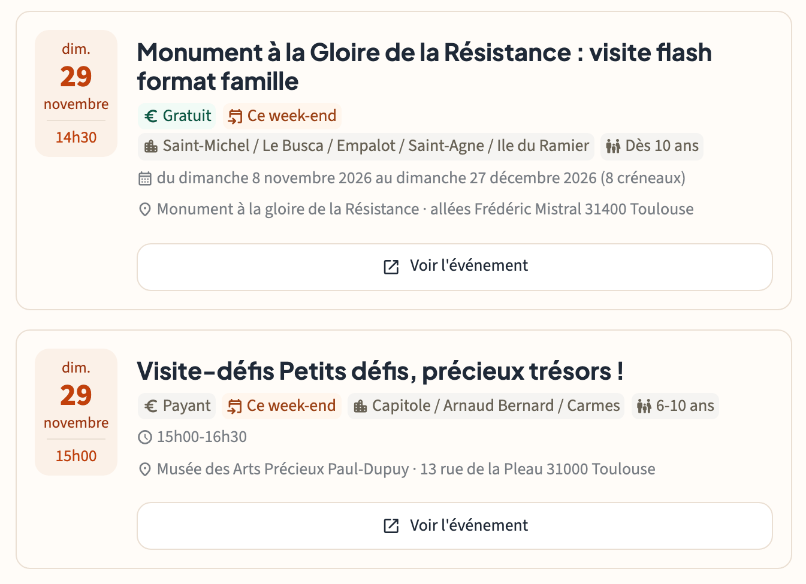
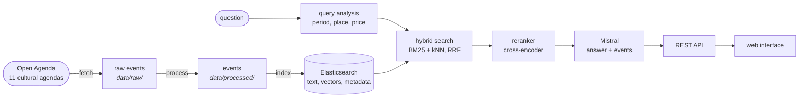

# cultural-events-rag

[](https://github.com/pstcricq/cultural-events-rag/actions/workflows/ci.yml) [](https://pstcricq.github.io/cultural-events-rag/) [](https://www.python.org) [](https://docs.astral.sh/uv/) [](https://github.com/astral-sh/ruff) [](https://mypy-lang.org) [](#test) [](LICENSE)

[](https://www.elastic.co/elasticsearch) [](https://mistral.ai) [](https://www.langchain.com) [](https://docs.ragas.io) [](https://fastapi.tiangolo.com) [](https://streamlit.io) [](compose.yaml) [](NOTICE)

A RAG assistant that recommends cultural events in Toulouse. It collects the events of the city's public cultural agendas from [Open Agenda](https://openagenda.com), indexes them in Elasticsearch, and answers a question in French with the events that fit it: the question is read for its period, place and price, the closest events are searched (lexical and vector search fused, then reranked by a cross-encoder), and a Mistral model writes the answer from those events only.

<p align="center"></p>

**Documentation:** [pstcricq.github.io/cultural-events-rag](https://pstcricq.github.io/cultural-events-rag/): the architecture and the choices behind each step, the evaluation, the deployment and the code reference.

## How it works



1. **Collection.** `fetch` downloads the events of 11 cultural agendas, the upcoming ones first; `process` turns them into one common format, drops those outside the city or the period, and merges the sessions of one activity.
2. **Indexing.** Each event becomes one document per chunk of its description, headed by its key facts. `index` embeds them with `mistral-embed` and writes them into a new Elasticsearch index, with their French text and their metadata.
3. **Search.** A question is analyzed by rules into filters (period, district or venue, free entry). The events the filters keep are ranked by BM25 and by vector, the two rankings fused, then the first 20 sorted again by a cross-encoder.
4. **Generation.** `ministral-14b-latest` answers from the 5 best events and returns the uids of those it recommends; every detail shown with the answer comes from the index.
5. **Evaluation.** A benchmark of 50 annotated questions measures the search configurations and the answers.

## What is here

| | |
|---|---|
| [`src/cultural_events_rag/`](src/cultural_events_rag) | the package: one subpackage per step (`collection`, `indexing`, `retrieval`, `generation`, `evaluation`), the `api`, the web interface (`ui`) and the `cultural-events-rag` command (`cli`) |
| [`data/benchmark/`](data/benchmark) | the benchmark: 50 annotated questions and the 1,850 frozen events they were judged on |
| [`reports/`](reports) | the reports of the last evaluations, Markdown and JSON |
| [`tests/`](tests) | the unit, integration and smoke tests |
| [`docs/`](docs), [`mkdocs.yml`](mkdocs.yml) | the documentation site |
| [`compose.yaml`](compose.yaml), [`Dockerfile`](Dockerfile) | the services and the image of the application |
| [`.env.example`](.env.example) | every setting, with its value |

## Requirements

- Python 3.12 and [uv](https://docs.astral.sh/uv/) 0.12.5
- make
- Docker, for Elasticsearch, the integration tests and the image
- A [Mistral](https://console.mistral.ai/api-keys) API key (the free plan is enough); an [Open Agenda](https://openagenda.com/settings/apiKey) key is optional

## Quick start

```bash
make install
make models
cp .env.example .env    # then fill in the keys and passwords
make docker-up
make fetch process index
make api
make ui
```

The web interface opens on http://127.0.0.1:8501, the API on http://127.0.0.1:8000 with its documentation at `/docs`. `make help` lists every target, `make <target> ARGS=--help` every option of its command.

`make install` installs the locked environment in `.venv` with the `rerank` (PyTorch, about 1 GB), `eval` and `ui` extras, and the git hooks. `make models` downloads the Hugging Face models run locally (the Mistral tokenizer, and the reranker unless `RERANK_AVAILABLE=false`); every other target runs Hugging Face offline.

## Configuration

Every setting comes from the environment, then from `.env`, and none has a default in the code: [`.env.example`](.env.example) lists them all with their values. `make config` prints the active settings, the secrets masked.

| Setting | |
|---|---|
| `MISTRAL_API_KEY` | the embedding model, the chat model and the judge |
| `OPENAGENDA_API_KEY` | the official Open Agenda API; without it, the OpenDataSoft mirror |
| `ELASTIC_PASSWORD`, `KIBANA_PASSWORD` | the passwords set by `make docker-up` |
| `ADMIN_API_KEY` | the key of `POST /rebuild` |
| `MAX_EVENTS` | the number of events to collect, or `all` |
| `RERANK_AVAILABLE` | whether this machine can run the reranker |
| `LLM_REQUESTS_PER_MINUTE` | the quota of the Mistral plan, 2 on the free plan |
| `ELASTICSEARCH_URL`, `API_URL` | where `make` reaches Elasticsearch and the API |

## Commands

Each `cultural-events-rag` command has a make target of the same name; `ARGS` passes its options.

| Step | Target | |
|---|---|---|
| Events | `make fetch` | download the raw events into `data/raw/` (`ARGS="--max-events 200"`) |
| | `make process` | turn them into the common format, `data/processed/events.jsonl` |
| Index | `make documents` | show the documents the events make (`ARGS="--uid 123"`) |
| | `make index` | embed them and write a new index, then move the alias onto it |
| | `make status` | show the index served, and whether it is up to date |
| | `make rebuild` | `fetch`, `process` and `index` in a row |
| Search | `make analyze Q="..."` | show the filters read in a question |
| | `make search Q="..."` | search the index (`ARGS="--mode hybrid --rerank"`) |
| Answer | `make ask Q="..."` | answer a question with the assistant |
| Evaluation | `make benchmark` | check the benchmark and build its index |
| | `make eval-retrieval` | compare the search configurations |
| | `make eval-generation` | evaluate the answers (`ARGS="--no-judge"`) |
| Services | `make api` | serve the API on http://127.0.0.1:8000 |
| | `make ui` | serve the web interface on http://127.0.0.1:8501 |

```bash
make ask Q="Un concert gratuit ce week-end à Saint-Cyprien ?"
```

## API

| Route | |
|---|---|
| `POST /ask` | `{"question": "Un concert de jazz ?", "today": "2026-10-19"}`: the answer, the filters read, and the events recommended, each with its title, venue, address, district, ages, dates, first slot in the period, price and link |
| `GET /health` | `ok`, or 503 with the reason: no assistant, no index, an outdated index, Elasticsearch unreachable |
| `GET /metadata` | the index served, the models, and the state of the last rebuild |
| `POST /rebuild` | fetch, process and index again, in the background; needs `ADMIN_API_KEY` in `X-API-Key` |

Errors: 422 for an empty or too long question (500 characters), 503 when the assistant or the index is not ready, 502 when Mistral fails after its retries, 409 when a rebuild is already running, 401 or 403 for `POST /rebuild` without its key.

## Docker

```bash
make docker-up                 # Elasticsearch, Kibana, the models, the API and the web interface
make docker-up S=elasticsearch # Elasticsearch alone, for make api on this machine
```

| | |
|---|---|
| `make docker-up` | build the image from this checkout, start the services, wait until healthy (`S=<service>` for some) |
| `make docker-ps` | the containers and their health |
| `make docker-logs` | the logs (`S=<service>`, `N=<lines>`) |
| `make docker-down` | stop the services, keep their data |
| `make docker-reset` | stop them and delete their volumes |

[`compose.yaml`](compose.yaml) is the same file in every environment: every value comes from the environment or `.env`, and the application runs from one image, `APP_IMAGE:APP_TAG`. On this machine make adds [`compose.dev.yaml`](compose.dev.yaml), which builds that image, and the profile `search`, which runs Elasticsearch and Kibana. A server runs `docker compose --profile search up -d` on `compose.yaml` alone, or without the profile with `API_ELASTICSEARCH_URL` pointing at an external Elasticsearch. Kibana opens on http://127.0.0.1:5601.

## Evaluation

The benchmark holds 50 French questions, each with the events a human judged relevant and a reference answer, judged on 1,850 frozen events. The search configurations, on the 45 questions with relevant events ([`reports/retrieval.md`](reports/retrieval.md)):

| Configuration | Hit@5 | Recall@5 | Precision@5 | MRR | Recall@20 |
|---|---|---|---|---|---|
| lexical | 0.93 | 0.81 | 0.64 | 0.92 | 0.79 |
| vector | **1.00** | 0.83 | 0.64 | 0.90 | 0.85 |
| hybrid | 0.96 | 0.84 | 0.65 | 0.92 | **0.89** |
| **hybrid + rerank** (served) | 0.96 | **0.89** | **0.69** | **0.93** | **0.89** |

The answers of the assistant ([`reports/generation.md`](reports/generation.md)): recommendation precision 0.92, recommendation recall 0.88, abstention on out-of-scope questions 0.80; scored by a Ragas judge, faithfulness 0.88 and answer relevancy 0.79. The [evaluation page](https://pstcricq.github.io/cultural-events-rag/guide/evaluation/) explains the metrics and their limits.

## CI

GitHub Actions runs one job per make target: `lint`, `typecheck`, `pre-commit`, `test-unit`, `coverage` and `docs-build`; `docker` builds the image, starts the API, the web interface and Elasticsearch on it with dummy secrets, and runs `make test-smoke`; `docs-publish` publishes the documentation on GitHub Pages from `main`. `make ci` runs every check on this machine. No secret is needed.

## Test

```bash
make test-all
make coverage
```

| | |
|---|---|
| `make test-unit` | the tests that need only the repository, also run before each push |
| `make test-integration` | the tests against a real Elasticsearch, started by testcontainers |
| `make test-smoke` | the services of `make docker-up`, checked from outside |
| `make test-all` | unit then integration tests (`SMOKE=1`: then smoke tests) |
| `make coverage` | unit and integration tests, failing under 95% of the lines |
| `make lint`, `make typecheck` | ruff, and mypy strict |
| `make pre-commit` | every git hook on every file |

## Documentation

```bash
make docs-serve
```

The site on http://127.0.0.1:8008, reloaded on save; `make docs-build` builds it into `site/`, every warning an error. The pages are under [`docs/`](docs), the code reference generated from the docstrings.

## Licence

The code, the documentation and the benchmark questions are under MIT, see [LICENSE](LICENSE). The events keep the licence of their source, the Licence Ouverte 2.0 of Etalab, with the attribution of each event, see [NOTICE](NOTICE).
