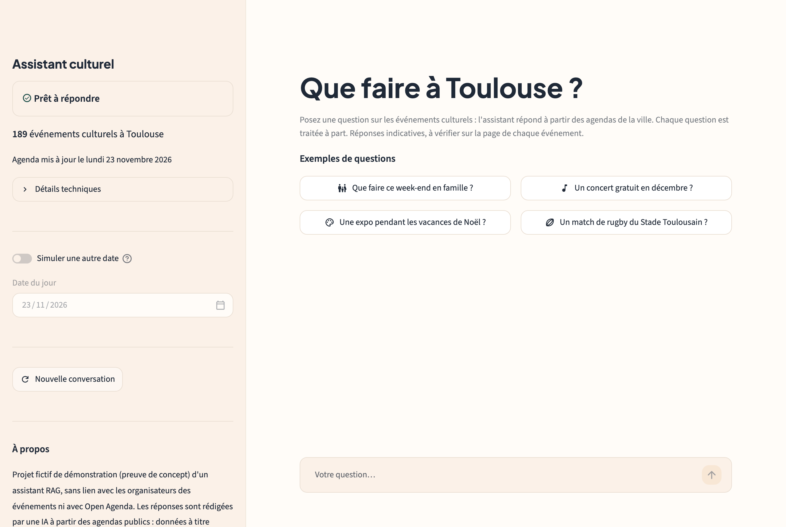

# Getting started

From a fresh clone to a question answered in the web interface.

## Requirements

- Python 3.12 and [uv](https://docs.astral.sh/uv/) 0.12.5: the project refuses any other uv version.
- make.
- Docker, for Elasticsearch, the integration tests and the image.
- A [Mistral API key](https://console.mistral.ai/api-keys): the free plan is enough.
- Optionally, an [Open Agenda API key](https://openagenda.com/settings/apiKey). Without it, the events come from the OpenDataSoft mirror of the public agendas, which needs no key.

## Install

```bash
git clone https://github.com/pstcricq/cultural-events-rag.git
cd cultural-events-rag
make install
make models
```

`make install` installs the locked environment into `.venv`, with three extras: `rerank` (sentence-transformers and PyTorch, about 1 GB), `eval` (Ragas) and `ui` (Streamlit), and installs the git hooks. Without the reranker, `uv sync` installs the rest.

`make models` downloads, once, the Hugging Face models run on this machine: the Mistral tokenizer (about 2 MB), which counts the tokens of each embedding request, and the reranker (about 2.3 GB). Every other target runs Hugging Face offline: a missing model is reported, never downloaded on the way. A machine that cannot run the reranker sets `RERANK_AVAILABLE=false`, and `make models` leaves it out.

## Configure

```bash
cp .env.example .env
make config
```

Fill in `.env`: the Mistral key, the Open Agenda key if any, and three long random strings for `ELASTIC_PASSWORD`, `KIBANA_PASSWORD` and `ADMIN_API_KEY`:

```bash
python -c "import secrets; print(secrets.token_urlsafe(24))"
```

`make config` prints the settings the application reads, the secrets only shown as set or not. Every setting is described in [Configuration](operations/configuration.md).

## Start Elasticsearch

```bash
make docker-up S=elasticsearch
```

Elasticsearch runs under Docker Compose on http://127.0.0.1:9200, with the `elastic` user and `ELASTIC_PASSWORD`. `make docker-up` alone also starts Kibana, the API and the web interface in containers (see [Docker](operations/docker.md)).

## Collect and index the events

```bash
make fetch
make process
make index
make status
```

`make fetch` downloads the events into `data/raw/`, `make process` turns them into `data/processed/events.jsonl`, and `make index` embeds them with `mistral-embed` and writes the index. `make status` shows the index served and whether it is up to date. `MAX_EVENTS=200` in `.env`, or `ARGS="--max-events 200"`, collects a sample while developing.

## Ask

```bash
make analyze Q="Un concert gratuit ce week-end ?"
make search Q="Un concert gratuit ce week-end ?" ARGS="--mode hybrid --rerank"
make ask Q="Un concert gratuit ce week-end ?"
```

`analyze` shows the filters read in the question, `search` the events found, `ask` the answer of the assistant. `ARGS="--today 2026-10-15"` asks as of another day.

## Serve

```bash
make api
make ui
```

The API serves on http://127.0.0.1:8000, its interactive documentation at `/docs`; the web interface on http://127.0.0.1:8501. The interface reaches the API at `API_URL`.

{ .shot-l }

*The first page: the state of the assistant in the sidebar, and four example questions.*

## Check

```bash
make ci
```

Lint, types, git hooks, the unit and integration tests with their coverage, and the documentation, as the CI runs them. See [Development](development.md).
