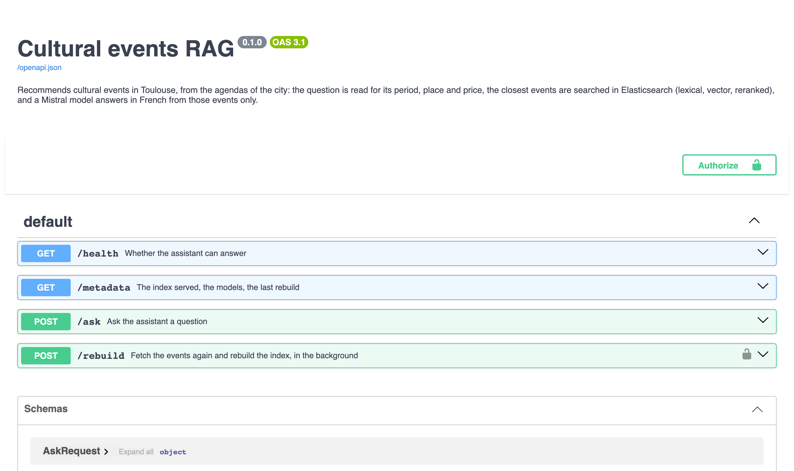

# API

```bash
make api
```

The assistant is served as a REST API (FastAPI, uvicorn) on http://127.0.0.1:8000, its interactive documentation at `/docs` and its OpenAPI schema at `/openapi.json`. The assistant is loaded once, at start: the Elasticsearch client, the embedding model, the reranker and the chat model, then shared by every request.

{ .shot-l }

*The interactive documentation at `/docs`, generated by FastAPI from the routes and the schemas.*

## Routes

| Route | Answer |
|---|---|
| `POST /ask` | the answer to a question, the filters read in it, and the events it recommends |
| `GET /health` | `ok`, or 503 with the reason |
| `GET /metadata` | the index served, the models and the search, the state of the last rebuild |
| `POST /rebuild` | 202: fetch, process and index the events again, in the background |

### `POST /ask`

```bash
curl -s http://127.0.0.1:8000/ask \
  -H 'Content-Type: application/json' \
  -d '{"question": "Un concert de jazz ?", "today": "2026-10-19"}'
```

`today` is optional, today in Toulouse by default. The answer:

```json
{
  "question": "Un concert de jazz ?",
  "today": "2026-10-19",
  "answer": "Je vous recommande le Concert de jazz du trio ...",
  "filters": {"date_from": "2026-10-19", "date_to": null, "district": null, "venue": null, "free": null},
  "events": [
    {
      "uid": "56158955",
      "title": "Concert de jazz",
      "venue": "Conservatoire de Toulouse",
      "address": "17 rue Larrey",
      "district": "Capitole / Arnaud Bernard / Carmes",
      "age_min": 6,
      "age_max": null,
      "dates": "vendredi 20 novembre 2026, 20h00-22h00; samedi 21 novembre 2026, 20h00-22h00",
      "next_slot": "2026-11-20T20:00:00+01:00",
      "is_free": true,
      "url": "https://openagenda.com/..."
    }
  ]
}
```

Every field of an event comes from the index, never from the generated text. `next_slot` is its first slot in the period of the question: a series can have started long before. `is_free` is `null` when the agenda does not give the price.

### `GET /health`

`{"status": "ok"}` when the assistant is loaded and the index served is up to date. Otherwise 503, with the reason in `detail`: the assistant could not load (a missing key or model), no index behind the alias, an index built otherwise than the code builds it now, or Elasticsearch unreachable. The server answers either way: its health is that of the server, and the reason tells what to fix. The cause of an Elasticsearch failure is logged.

### `POST /rebuild`

Fetches, processes and indexes the events again, as `make rebuild` does, in the background: 202 at once, the progress on `/metadata`, 409 while a rebuild is running. It needs `ADMIN_API_KEY` in the `X-API-Key` header (401 otherwise), and is turned off when that key is not set (403). The questions keep their answers from the index served until the new one is complete; a failed rebuild leaves it in place.

## Errors

| Code | When |
|---|---|
| 401 | `POST /rebuild` without the right key |
| 403 | `POST /rebuild` when `ADMIN_API_KEY` is not set |
| 409 | a rebuild is already running |
| 422 | an empty question, or one longer than 500 characters |
| 502 | Mistral failed after its retries |
| 503 | no assistant, no index, an outdated one, or Elasticsearch unreachable |

The answers share the quota of the Mistral plan: on the free plan, one answer every 30 s, the questions asked at once waiting their turn.

## Design

The routes stay thin. The service (`api.service`) holds the assistant and the state of the rebuild; the packages of each step do the work. The API starts even when the assistant cannot load, so that `/health` can say why. The rebuild runs in a background task with a lock, its outcome stored for `/metadata`, never raised.
