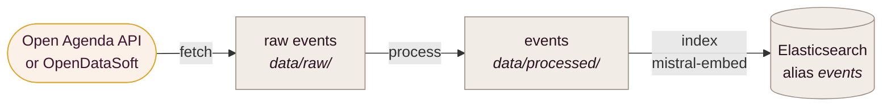
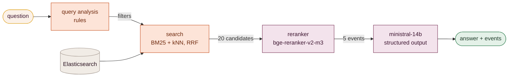
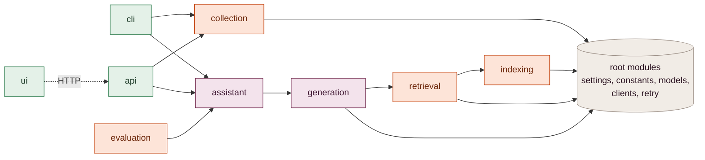

# Architecture

## The pipeline

**Offline**, on demand (`make rebuild`, or `POST /rebuild`): the agendas become an index.

**Online**, for each question: four steps, each a package of its own.

## The packages

The package `cultural_events_rag` has one subpackage per step. Each depends only on the steps before it and on the modules at the root, never on a later one:

| Package | Step | Depends on |
|---|---|---|
| `collection` | download the raw events, process them into the common format | root |
| `indexing` | turn the events into documents, embed them, write the index | root |
| `retrieval` | analyze a question, search the index, rerank | `indexing` |
| `generation` | write the answer from the events found | `retrieval` |
| `evaluation` | measure the search and the answers on the benchmark | every step |
| `api` | serve the assistant and the rebuild over HTTP | every step |
| `ui` | the web interface, a client of the API | `api` schemas only |
| `cli` | the `cultural-events-rag` command, one module per command | every step |

At the root: `assistant.py` puts the steps together, `settings.py` reads the environment, `constants.py` holds what is tied to the city, `models.py` the data models, `mistral.py` and `elastic.py` the clients, `retry.py` the retry policy.

## The assistant

`assistant.py` is the one place where the served configuration is written: the search mode (`SEARCH_MODE = "hybrid"`) and whether to rerank (`RERANK = True`), the choices the [evaluation of the search](evaluation.md) made. The search itself offers every mode and leaves the choice to its caller. The commands that answer a question (`ask`, the API, the evaluation of the answers) all load the assistant the same way, so they serve the same thing.

## Principles

**Settings are not choices.** A setting is what an environment decides: its keys, where its services are, what its machine and its Mistral plan allow. The choices of the design (chunk size, models, search mode) are constants next to the code that uses them, the same everywhere, changed by a commit that the evaluation measures. See [Configuration](../operations/configuration.md).

**No default for a setting.** Every setting is unset until the environment sets it, and the code that needs one refuses to run without it, naming it. A forgotten value is an error, not a silent default.

**The index records how it was built.** Each index stores a signature: the embedding model, the chunking, the format of the documents, the mappings. The search refuses an index the code would now build otherwise, and `status` says what differs.

**Facts come from the index.** The chat model writes the text of the answer and names the events it recommends; their dates, place, price and link come from the index, never from the generated text.

**Rules before models.** The constraints of a question are read by tested rules, not by a model: the same question always gives the same filters, and each phrasing has its test.

**One build, one swap.** A build writes a new index and moves the alias onto it only once complete. The questions are answered from the previous index meanwhile, and a failed build leaves it untouched.
