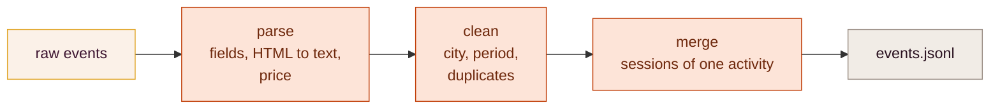

# Collection

```bash
make fetch
make process
```

## Sources

The events come from the public agendas of [Open Agenda](https://openagenda.com), through one of two sources:

| Source | When | Pagination |
|---|---|---|
| [Open Agenda API](https://developers.openagenda.com/) v2 | `OPENAGENDA_API_KEY` is set | `after` cursor, 300 events per page |
| [OpenDataSoft dataset](https://public.opendatasoft.com/explore/dataset/evenements-publics-openagenda/) `evenements-publics-openagenda` | without a key | `offset`, 100 records per page |

The OpenDataSoft mirror needs no key, which suits a laptop; the official API is the source of record for a server. Both return the same events in different formats: each has its parser, and both end in the same common format.

## The agendas

`constants.py` lists 11 agendas picked by hand for culture: the libraries of Toulouse, the Musée des Augustins, the Conservatoire, the Musée Paul-Dupuy, the art-house cinemas (SCARE), Shotgun, Le Cratère, the European Heritage Days in Occitanie, the Quai des Savoirs, the Monuments of Toulouse and the Théâtre Jules-Julien. Agendas outside culture, such as employment services or local associations, are left out. Some agendas also publish events of other cities, hence a filter on the city.

## What is collected

`fetch` collects, for each agenda, the upcoming events first, then those finished within the last 365 days, which answer the questions about the past.

- **Upcoming events, most recently updated first.** Sorting by date would fill the sample with the next few weeks; sorting by update spreads it over the coming months.
- **A quota per agenda.** With `MAX_EVENTS` set to a number, the quota is split evenly between the agendas, so that the libraries, by far the largest, do not fill the sample.
- **Each event once.** An event published by several agendas is kept by the first one and does not count in the quota of the others; an event already seen is replaced by the next one.

`MAX_EVENTS` is required: a number for a sample (200 is enough while developing), or `all`. A forgotten cap is not a choice.

Transient failures (rate limit, server error, network error) are retried with an exponential backoff, each retry logged; any other error, such as an invalid key, fails at once.

## Processing

`process` reads the raw file of the source and writes `data/processed/events.jsonl`, one event per line, sorted by uid so that two runs on the same events give the same file. It calls no API and can be run again at will.



**Parse.** Each source has its parser. The fields kept are mapped to the common `Event` model, the HTML descriptions turned into text (block tags become line breaks), the multilingual fields read in French. The personal data of the contributors, present in the OpenDataSoft records, is not kept, nor are the images. A record that makes no valid event (no title, no date) is counted and dropped.

**Price.** Whether an event is free is read from its conditions:

| Conditions | `is_free` |
|---|---|
| "Gratuit", "Entrée libre" | `True` |
| "Tarif : 6€", "Gratuit - 6 ans / 5€", a museum ticket | `False` |
| none, "Sur inscription", "Participation libre" | `None` |

An unknown price is never presented as free: a visitor would find out on site.

**Clean.** Events outside the city, finished before the collected period, or seen twice are dropped, each reason counted.

**Merge.** Some agendas publish each session of an activity as a separate event: a guided tour once per date. Left apart, they would fill the results with one activity and repeat the same text in the index. The sessions are merged into one event: the next session gives its uid and link, all of them their dates.

The counts of each step are printed: events kept, dropped by reason, sessions merged.
