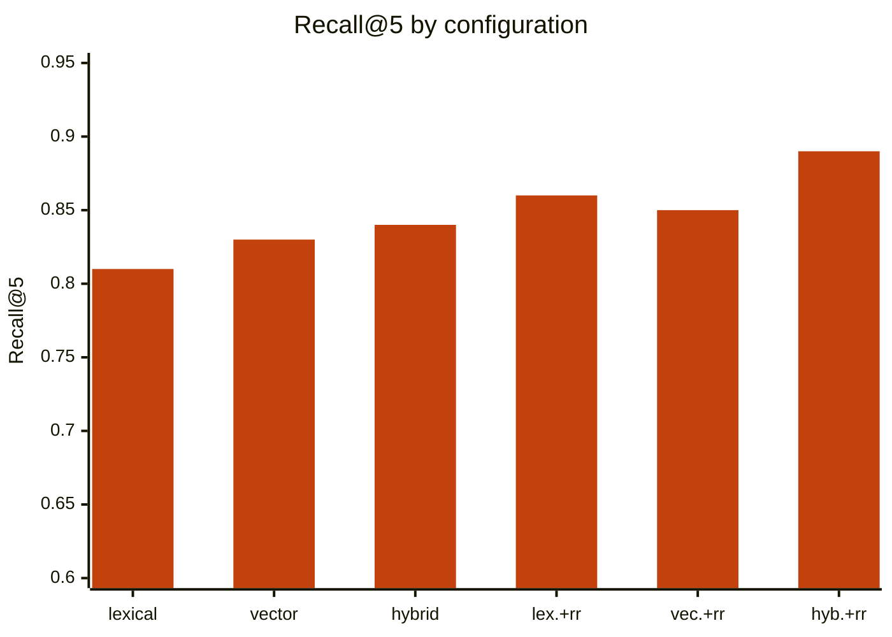

# Evaluation

```bash
make benchmark
make eval-retrieval
make eval-generation
```

## The benchmark

The benchmark, in `data/benchmark/`, is versioned:

- `questions.json`: 50 questions in French, each with the events a human judged relevant and a reference answer, all judged as of a reference date (Monday 19 October 2026), so that "ce week-end" keeps the same meaning at each run;
- `events.jsonl`: the 1,850 events they were judged on, frozen.

| Category | Questions | Example |
|---|---|---|
| theme | 11 | "Je cherche une soirée techno à Toulouse" |
| entity | 8 | "Quand a lieu Harpissima ?" |
| audience | 7 | "Une activité pour un enfant de 6 ans" |
| time | 7 | "Des événements pour Halloween ?" |
| practical | 6 | "Un concert gratuit" |
| place | 6 | "Que faire au couvent des Jacobins ?" |
| out of scope | 5 | "Un match de rugby du Stade Toulousain" |

The relevant events were drafted by pooling the candidates of several search methods, then reviewed by hand. `make benchmark` checks that every relevant event is among the frozen events, then writes them into Elasticsearch under their own alias, `events-benchmark`, by the same build as the application. The evaluation thus measures the search on the very events the questions were judged on, whatever the application currently holds. The index is rebuilt only when missing, outdated, or holding other events.

## The search

`make eval-retrieval` searches each question of the benchmark as of its reference date, with each configuration: `lexical`, `vector` and `hybrid`, without then with the reranker. No language model is involved: the same run gives the same numbers.

For a question, \(R\) is the set of its relevant events and \(T_k\) the first \(k\) events found:

| Metric | For a question | Meaning |
|---|---|---|
| Hit@5 | \(\mathbb{1}[R \cap T_5 \neq \emptyset]\) | a relevant event among the first 5 |
| Recall@5 | \(\dfrac{\lvert R \cap T_5 \rvert}{\min(5, \lvert R \rvert)}\) | the relevant events among the first 5, out of the most there can be |
| Precision@5 | \(\dfrac{\lvert R \cap T_5 \rvert}{5}\) | the share of the first 5 that is relevant |
| MRR | \(\dfrac{1}{r}\) | \(r\), the rank of the first relevant event |
| Recall@20 | \(\dfrac{\lvert R \cap T_{20} \rvert}{\min(20, \lvert R \rvert)}\) | the same among the 20 candidates of the reranker |

Recall is capped at \(\min(k, |R|)\): with 200 events relevant to "en décembre", five relevant events in the first five is a perfect answer, not 5 / 200. \(k = 5\) is what the assistant shows; \(k = 20\) the candidates of the reranker, which can only bring up an event among them.

Results on the 45 questions with relevant events ([`reports/retrieval.md`](https://github.com/pstcricq/cultural-events-rag/blob/main/reports/retrieval.md)):

| Configuration | Hit@5 | Recall@5 | Precision@5 | MRR | Recall@20 |
|---|---|---|---|---|---|
| lexical | 0.93 | 0.81 | 0.64 | 0.92 | 0.79 |
| vector | **1.00** | 0.83 | 0.64 | 0.90 | 0.85 |
| hybrid | 0.96 | 0.84 | 0.65 | 0.92 | **0.89** |
| lexical + rerank | 0.93 | 0.86 | 0.67 | 0.90 | 0.79 |
| vector + rerank | 0.96 | 0.85 | 0.66 | **0.93** | 0.85 |
| hybrid + rerank | 0.96 | **0.89** | **0.69** | **0.93** | **0.89** |



The hybrid search finds more of the relevant events among its candidates (Recall@20 0.89) than either search alone: BM25 and the vectors miss different events. The reranker then brings them up into the first five. Hybrid and reranked is the configuration the assistant serves.

By category, the place and entity questions are nearly solved by any configuration (a name in the question matches a name in the event); the theme and audience questions gain the most from the reranker (Recall@5 0.64 to 0.78, and 0.76 to 0.88).

The report also counts, question by question, how often each configuration does better than each other, since a mean can hide a few large gains or losses, and shows what comes first for the out-of-scope questions with the first score of the reranker.

!!! note "How far to trust these numbers"
    The configuration was chosen on these same 50 questions: its scores are slightly optimistic, and a gap of a few points between two configurations is not necessarily real.

## The answers

`make eval-generation` asks each question to the whole assistant, as of its reference date, with the configuration served only: the search was measured above, this measures what the chat model does with the events it is given. \(C\) is the set of events given to the model, \(A\) those its answer recommends.

**Exact checks**, without any judge:

| Metric | For a question | Meaning |
|---|---|---|
| Recommendation precision | \(\dfrac{\lvert A \cap R \rvert}{\lvert A \rvert}\) | the share of the events recommended that are relevant |
| Recommendation recall | \(\dfrac{\lvert A \cap R \cap C \rvert}{\lvert R \cap C \rvert}\) | the share of the relevant events given that it recommends |
| Abstention | \(\mathbb{1}[A = \emptyset]\) | an out-of-scope question answered without any event |

**An LLM judge**, three metrics of [Ragas](https://docs.ragas.io) for the questions with relevant events:

- **faithfulness**: the share of the claims of the answer supported by the events given (1: nothing invented);
- **answer relevancy**: the cosine between the question and questions the judge writes back from the answer;
- **factual correctness**: the claims of the answer and of the reference answer checked against each other (F1).

The context precision and context recall of Ragas are left out on purpose: they judge the events given to the model, which the evaluation of the search already measures against human judgments. The out-of-scope questions are left out of the judge too: answer relevancy rates a refusal 0, and their abstention is measured exactly.

Results ([`reports/generation.md`](https://github.com/pstcricq/cultural-events-rag/blob/main/reports/generation.md)):

| Metric | Mean | Questions |
|---|---|---|
| Recommendation precision | 0.92 | 43 |
| Recommendation recall | 0.88 | 43 |
| Abstention (out of scope) | 0.80 | 5 |
| Faithfulness | 0.88 | 45 |
| Answer relevancy | 0.79 | 45 |
| Factual correctness | 0.38 | 45 |

Factual correctness is low by construction: a reference answer picks a few events when many are relevant, and an answer citing others loses points without being wrong. The judge is the model that wrote the answers, which tends to rate them well: its scores compare versions of the assistant rather than tell an absolute quality.

## Cost and time

The free Mistral plan allows 2 requests a minute to its chat models, shared by the assistant and the judge. The answers take about 25 minutes; the judge about 2 h 40 more, 7 calls per question (2 for faithfulness, 1 for answer relevancy, 4 for factual correctness). `ARGS="--no-judge"` keeps the exact checks only. Each evaluation shows its estimated time and asks before running; `ARGS="--yes"` runs it without asking.

The evaluation is run to compare versions of the assistant, not at each change. Its reports are versioned: their history shows the effect of each change, and the JSON files compare two runs question by question.
