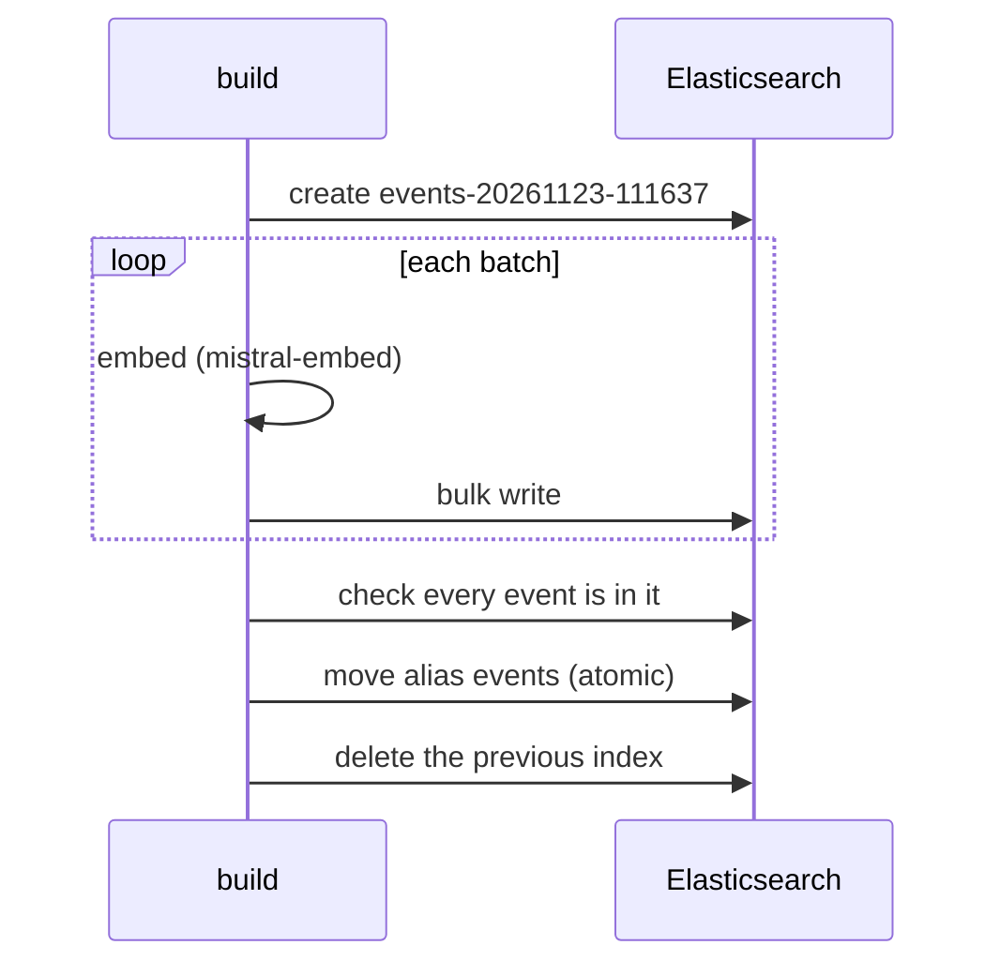

# Indexing

```bash
make documents
make index
make status
```

## Documents

Each event becomes one document per chunk of its description. Every chunk starts with the header of the event, so that its vector stays tied to the event it describes:

```text
Titre : Visite-défis Petits défis, précieux trésors !
Dates :
- dimanche 29 novembre 2026, 15h00-16h30
Lieu : Musée des Arts Précieux Paul-Dupuy, 13 rue de la Pleau 31000 Toulouse
Tarif : payant
Public : de 6 à 10 ans
Mots-clés : visite, famille
Proposé par : Musée des arts précieux Paul-Dupuy

Un atelier ludique pour les enfants de 6 à 10 ans, mêlant observation, mime et dessin...
```

The values are written in French, in Paris time, with absolute dates only ("samedi 19 septembre 2026", never "demain"), so that a text written today stays true tomorrow. A series of more than 7 days is written as a range ("du jeudi 1 octobre 2026 au jeudi 31 décembre 2026 (40 créneaux)"). The header holds the title, a summary when the description does not start with it, the dates, the place, the status when it is not "Programmé", the price (always written: "gratuit", "payant" or "non précisé"), the conditions, the audience, the keywords and the agenda.

`make documents` shows the documents the events make: a summary, or every document of one event with `ARGS="--uid 123"`.

## Chunking

A description longer than 1,000 characters (`CHUNK_SIZE`) is split, each chunk repeating the last 150 characters (`CHUNK_OVERLAP`) of the previous one. The splitter cuts at the most natural boundary that fits: a line (a paragraph of the HTML), then a sentence, then a word. Most descriptions fit in one chunk: about 190 events give about 290 documents.

Beside its chunk, each document carries the whole text of its event, header and whole description, in its metadata. That is what the chat model reads: the best chunk of a long description can leave out its sessions or its prices.

## Embedding

`make index` embeds the documents with `mistral-embed` (1,024 dimensions), in batches of up to 40,000 characters: about 15k tokens at 2.7 characters per token of French, one request each, under the 16k tokens a request of the Mistral client accepts. The tokens are counted with the Mistral tokenizer of Hugging Face, loaded explicitly: without it, the client would silently count characters. A batch is retried on a rate limit or a server error, with an exponential backoff, visibly; the built-in retries of the client, a silent fixed wait, are turned off.

## The Elasticsearch index

Each entry stores the text of a chunk, its vector and the metadata of its event:

| Field | Type | Used for |
|---|---|---|
| `text` | `text`, French analyzer | the lexical search (BM25): elisions, stop words, light stemming |
| `vector` | `dense_vector`, cosine, `flat` | the vector search: exact kNN |
| `timings` | `date_range`, one per slot | the period filter: a slot intersecting the period |
| `district` | `keyword` | the district filter |
| `venue` | `keyword` and `venue.folded` | the venue filter, on part of the name, without case nor accents |
| `is_free` | `boolean` | the free-entry filter |
| `location` | `geo_point` | stored |
| `event_text` | `text`, not indexed | the whole event, given to the chat model |

The vector search is exact: the question is compared with every vector, by cosine. At a few thousand documents it is instant and finds the true nearest neighbours; an approximate graph (HNSW) only pays off at hundreds of thousands. The index has one shard and no replica: one node, a few thousand documents.

The `folded` analyzer cuts a venue name into words, in lower case, without accents nor elisions: "Chapelle des Carmélites" is found by "carmelites".

## Build and swap



Each build writes a new index, named after the alias and the build time, then moves the alias `events` (`ELASTICSEARCH_INDEX`) onto it in one atomic request, once every event is in it. A failure before the move deletes the new index and leaves the alias as it was: the questions are answered from the previous index throughout. The previous index is deleted after the move; a failure there leaves it aside, reported.

## Signature and status

Each index stores, in its `_meta`, what it was built with: the embedding model, the chunk size and overlap, the document format (`DOCUMENT_FORMAT`) and the mapping version (`MAPPING_VERSION`), raised whenever the text or the fields change. `make status` shows the index served, its documents, when it was built, and what differs from what the code builds now. The search, the assistant and the API refuse an outdated index: a change of the documents is never searched with vectors of the former ones.
