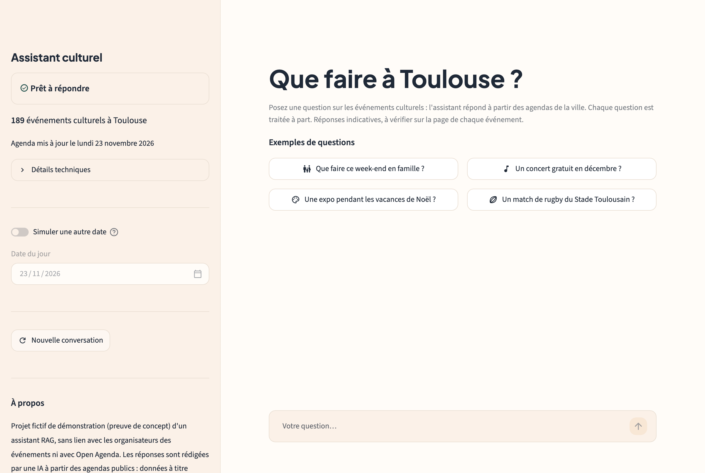
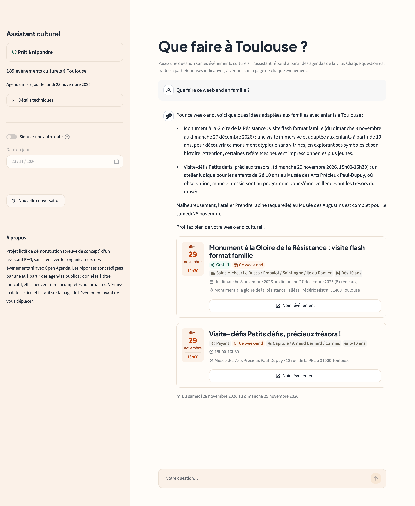
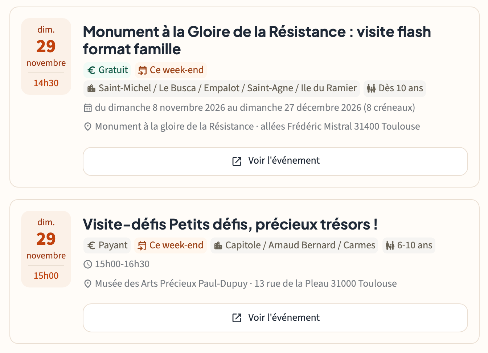

# Web interface

```bash
make api
make ui
```

The web interface is a chat with the assistant, served by [Streamlit](https://streamlit.io) (the `ui` extra) on http://127.0.0.1:8501.

{ .shot-l }

*The first page: the state of the assistant, the options, and four example questions.*

## A client of the API

The interface never calls the RAG code: it is a client of the API at `API_URL`, as any front end would be, and reads its answers with the schemas of the API, the one contract both sides keep to. It needs no secret. Under Docker Compose it runs from the same image as the API and reaches it by its service name, `http://api:8000`.

## The answer

The answer is written as it appears, word by word. It is followed by a card per event it recommends, the most relevant first:

{ .shot-s }

*A whole conversation, as of 23 November 2026: the question, the answer, the cards, then the period read in the question.*

{ .shot-m }

*Two cards: the tile of the first slot, the badges under the title, the dates, the place and the link.*

- **The tile** on the left gives the day and time of the first slot of the event in the period of the question.
- **The title**, then **the badges**:
    - the price: free, paid, or "tarif non précisé" when the agenda does not say;
    - how soon it comes, within a week of the day of the question: "Ce soir", "Aujourd'hui", "Demain", "Ce week-end", "Dans 3 jours";
    - the district, and the ages it is for when the agenda gives them.
- **The slots** for an event of one day, or **the dates** of an event of several days or a series.
- **The venue and its address.**
- **The link** to the page of the event, across the whole card.

Below the cards, what the question was read for: the period, the district or venue, free entry. Each question is answered on its own, as the API does: the chat only keeps the previous answers on screen.

## The sidebar

- whether the assistant can answer (`GET /health`), with the reason when it cannot;
- the events of the index, the day it was built, a rebuild running (`GET /metadata`), and the models in a "Détails techniques" section;
- a switch to ask the questions as of another day, the `today` of `POST /ask`;
- a button to start a new conversation;
- what the assistant is: a fictional proof of concept, not linked to the organizers nor to Open Agenda, whose answers, written by a language model, are indicative and to be checked on the page of each event.

Rebuilding the index stays out of the interface: it is an action of the administrator, through `POST /rebuild` and its key.

## Errors

Each failure of the API has its message: unreachable, too slow (two minutes, an answer waiting its turn under the quota of the Mistral plan), a question refused (422), the index missing or outdated (503, with the reason the API gives), Mistral failing (502).

## Theme

`.streamlit/config.toml` sets a warm light theme: brick orange on cream, rounded corners, headings in Plus Jakarta Sans (Google Fonts, sans-serif when it cannot load). The page shows no image of the events: their credits would have to be carried, and the cards hold the facts.
