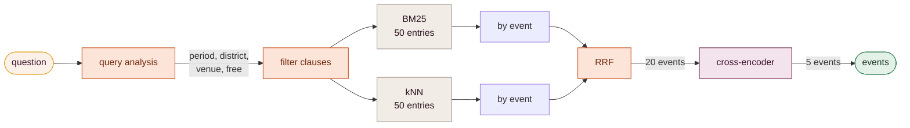

# Search

```bash
make analyze Q="Un concert gratuit ce week-end à Saint-Cyprien ?"
make search Q="Un concert gratuit ce week-end à Saint-Cyprien ?" ARGS="--mode hybrid --rerank"
```



## Query analysis

A vector captures a meaning ("en famille", "techno"), not a date ("ce week-end"), and holds a place or a price only loosely. The constraints of a question are therefore read by rules, then applied as exact filters on the metadata before any ranking. The rules use no model: the same question always gives the same filters, and every phrasing has its test.

| Constraint | Examples |
|---|---|
| Period | "ce soir", "demain", "ce week-end", "la semaine prochaine", "en décembre", "du 20 au 25 octobre", "samedi prochain", "cet été", "à Noël", "pendant les vacances de la Toussaint", "le mois dernier" |
| Free entry | "gratuit", "entrée libre" |
| District | one of the districts of the index, or one of the neighbourhoods it groups ("Saint-Cyprien") |
| Venue | the distinctive part of a venue name of the index ("Jacobins" for "Couvent des Jacobins"), any case, with or without accents |

- **Periods** are computed from the day of the question. A named period takes its next occurrence, or the current one; for a question about the past, its last one. The holidays whose dates change every year (the Toussaint and Noël school holidays, the Heritage Days) are taken at their widest.
- **No period, or one under way**, means events from today: finished events only answer a question about the past.
- **Free entry** keeps the free events and those whose price the agenda does not give: many free events do not say so. Only the paid ones are left out, and the answer says which price is unknown.
- **Places** are those of the index served: its districts and venues are read from Elasticsearch. The city, its département and the word "lieu" name no place, nor do the words that give the type of a venue ("couvent", "musée") without its name.

`make analyze` shows the filters of a question; `ARGS="--today 2026-10-15"` asks it as of another day.

## Lexical, vector, hybrid

Elasticsearch applies the filters first, then ranks only the entries they keep:

| Mode | Ranking |
|---|---|
| `lexical` | BM25 on the French text of the entries |
| `vector` | cosine between the vector of the question (`mistral-embed`) and those of the entries |
| `hybrid` | both rankings, fused by Reciprocal Rank Fusion |

Each search ranks 50 entries (`CANDIDATES`). The entries are chunks: each ranking is grouped by event, an event at the rank of its best chunk, before the fusion and the cut. Reciprocal Rank Fusion scores each event by the sum, over the rankings it is in, of

$$
\text{RRF}(e) = \sum_{r} \frac{1}{k + \text{rank}_r(e)}, \qquad k = 60
$$

and is computed in Python: the RRF of Elasticsearch needs a paid licence. It needs no calibration of the BM25 and cosine scores, which live on different scales.

## Reranking

A cross-encoder, `BAAI/bge-reranker-v2-m3`, sorts the first 20 events again (`RERANK_CANDIDATES`). The vector search encodes the question and each chunk apart, so that the vectors of the chunks are computed once, at indexing. A cross-encoder reads the question and a chunk together, in one pass of the model, and scores how well the chunk answers it: far more exact, far too slow for the whole index, hence applied to the first candidates only. It reads the best chunk of each event, up to 512 tokens per pair; a chunk is 300 to 400 tokens, so none is cut.

The model runs locally with sentence-transformers and PyTorch (the `rerank` extra): about 2.3 GB on disk, 2 to 3 GB of memory, a few seconds to load. A reranked search takes under a second on the GPU of a Mac, about 10 s on the CPU of a container. A machine that cannot run it sets `RERANK_AVAILABLE=false` and serves the hybrid search alone.

## The configuration served

The search offers every mode and the reranker; it makes no choice. The [evaluation](evaluation.md) compared them on the benchmark, and the assistant serves the best: hybrid, then reranked. Recall@5 rises from 0.81 (BM25) and 0.83 (vector) to 0.84 (hybrid) and 0.89 (hybrid and reranked).

The search keeps the 5 best events (`SEARCH_K`): those given to the chat model and shown.
