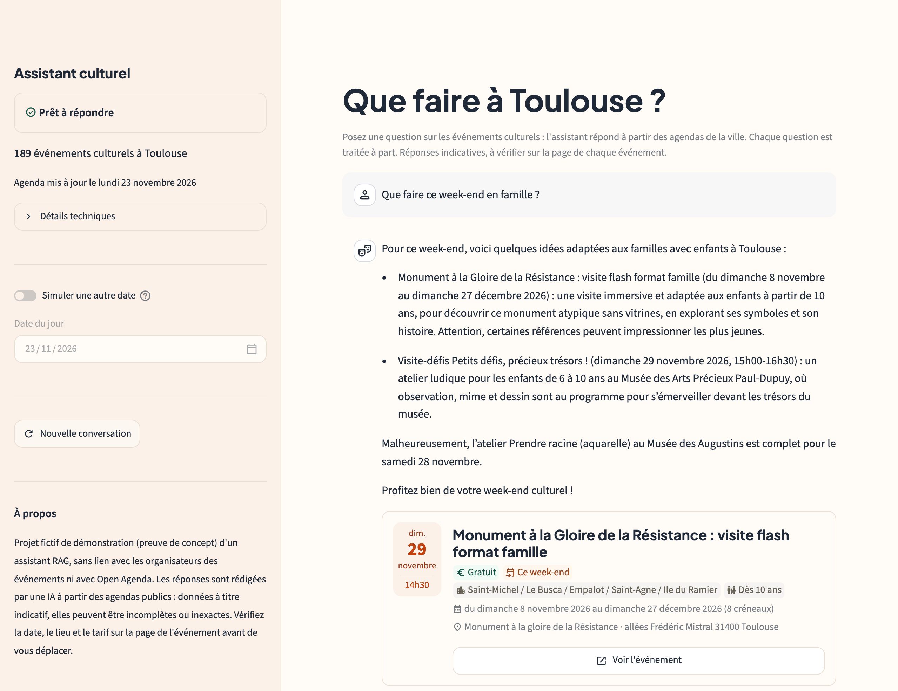
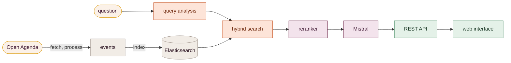

RAG assistant · Toulouse · Open Agenda

# Que faire à Toulouse ?

:material-account-outline: « Un concert gratuit ce week-end à Saint-Cyprien ? »

An assistant that recommends the cultural events of Toulouse. It reads a question in French for its period, place and price, searches the events of the city's public agendas by their words and their meaning, and lets a Mistral model answer from those events only, every date, place and price taken from the agendas.

[Get started](getting-started.md){ .md-button .md-button--primary } [How it works](guide/architecture.md){ .md-button } [Source code](https://github.com/pstcricq/cultural-events-rag){ .md-button }

This site is the technical guide: how each step is built and why, how the assistant is measured, how to run and deploy it. To install and run the project quickly, the [README](https://github.com/pstcricq/cultural-events-rag#readme) is the shorter path.

## Tonight's figures

Measured on the benchmark of 50 annotated questions; the numbers change with each evaluation.

  
Recall@5 of the search0.81 → 0.89BM25 alone, then hybrid search reranked: the configuration served.

  
Recommendation precision0.92The share of the events an answer recommends that are relevant.

  
Faithfulness0.88The claims of an answer supported by the events given, scored by Ragas.

  
Out of scope4 / 5Questions outside culture answered without any event.

  
Agendas11Libraries, museums, conservatory, theatres, cinemas, heritage days.

  
Tests544Unit, integration against a real Elasticsearch, smoke; 99% of the lines.

## The programme

<a href="guide/collection/"><strong>Collect</strong>11 agendas, one common format, sessions merged</a>
<a href="guide/indexing/"><strong>Index</strong>French text, vectors and metadata in Elasticsearch</a>
<a href="guide/search/"><strong>Search</strong>rules for the filters, BM25 and kNN fused, reranked</a>
<a href="guide/generation/"><strong>Answer</strong>Mistral writes, the index gives the facts</a>
<a href="guide/evaluation/"><strong>Measure</strong>50 questions, search and answers compared</a>

## On stage

{ .shot-l }

*The web interface, a client of the REST API: the answer, then a card per event with its day, its badges, its slots and its place.*

## Where to go next

-   :material-rocket-launch-outline:{ .lg .brick } __Getting started__

    Install, configure, collect and index the events, ask a question.

    [:octicons-arrow-right-24: Install and run](getting-started.md)

-   :material-sitemap-outline:{ .lg .brick } __Architecture__

    The pipeline, its packages, and the principles behind them.

    [:octicons-arrow-right-24: How it is built](guide/architecture.md)

-   :material-chart-bar:{ .lg .brick } __Evaluation__

    The benchmark, the metrics, and what they say.

    [:octicons-arrow-right-24: How it is measured](guide/evaluation.md)

-   :material-api:{ .lg .plum } __API__

    Routes, answers and errors of the REST API.

    [:octicons-arrow-right-24: Ask over HTTP](guide/api.md)

-   :material-docker:{ .lg .plum } __Docker__

    The image, the services, and how a server runs them.

    [:octicons-arrow-right-24: Deploy](operations/docker.md)

-   :material-scale-balance:{ .lg .plum } __Decisions__

    The choices of the project and their reasons.

    [:octicons-arrow-right-24: Why it is so](project/decisions.md)

The project is a proof of concept for a cultural-events platform, fictional and not affiliated with the organizers nor with Open Agenda. The application speaks French, the language of its events and users; the code and this documentation are in English.
