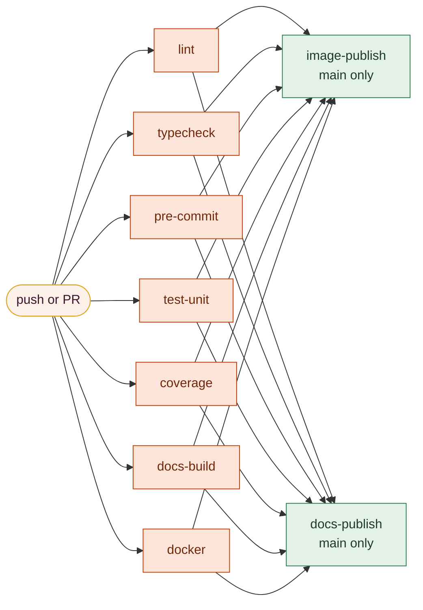

# CI

GitHub Actions runs [`.github/workflows/ci.yml`](https://github.com/pstcricq/cultural-events-rag/blob/main/.github/workflows/ci.yml) on every push to `main` and every pull request: one job per make target of the same name, in parallel.

| Job | Runs | Checks |
|---|---|---|
| `lint` | `make lint` | ruff check and format |
| `typecheck` | `make typecheck` | mypy strict, with the `rerank`, `eval` and `ui` extras so that the calls to sentence-transformers, Ragas and Streamlit are checked |
| `pre-commit` | `make pre-commit` | every git hook on every file, among them a secret scan |
| `test-unit` | `make test-unit` | the tests that need only the repository |
| `coverage` | `make coverage` | the unit and integration tests, with an Elasticsearch started by testcontainers; fails under 95%, the coverage of each file in the summary of the run |
| `docs-build` | `make docs-build` | the documentation site, every warning an error |
| `docker` | `make test-smoke` | the image built (not pushed), the API, the web interface and Elasticsearch started on it with dummy secrets and no reranker, then the smoke tests |
| `image-publish` | | the image on GitHub Container Registry, `ghcr.io/pstcricq/cultural-events-rag`, from `main` once every check passes |
| `docs-publish` | | the site of `docs-build` on GitHub Pages, from `main` once every check passes |

## The published image

`image-publish` builds the image for amd64 and arm64, the arm64 half under emulation (QEMU), and pushes it with two tags:

| Tag | |
|---|---|
| `sha-<commit>` | one per commit of `main`, never moved: what a server pins, so that it runs exactly what the CI checked |
| `latest` | the last commit of `main`, to try the project |

It runs only on `main`, after every other job: an image is never published from a pull request, nor before its tests, its smoke tests and its documentation pass. It needs no secret either: the job signs in to the registry with the `GITHUB_TOKEN` of the run, allowed to write packages for this job only. The image carries no setting and no secret, all given by the environment of the server.

No secret is needed: the tests fake Mistral and Open Agenda, and start their own Elasticsearch. Every job installs with `uv sync --locked`, which fails when `uv.lock` no longer matches `pyproject.toml`. The uv packages, the hook environments and the layers of the image are cached between runs; a new push cancels the run in progress on the same branch.

The `docker` job runs docker compose on `compose.yaml` alone, as a server does, on the image the job built, with the profile `search`.

`make ci` runs every check of the CI but `docker` on this machine.
