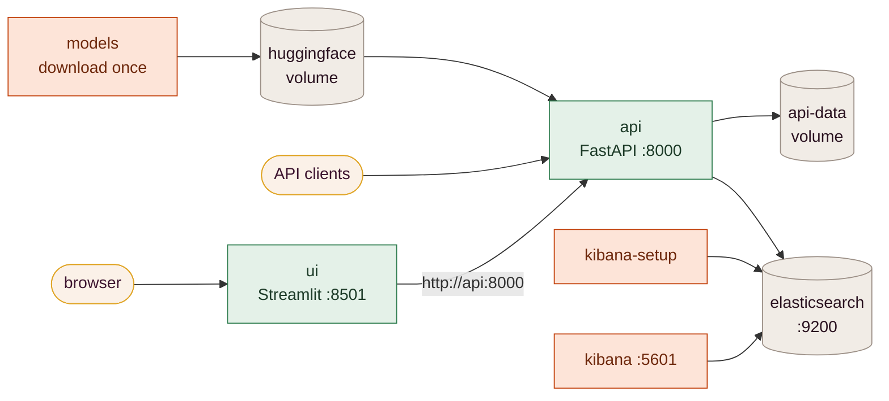

# Docker

```bash
make docker-up
```

## The services



| Service | Image | |
|---|---|---|
| `elasticsearch` | `docker.elastic.co/elasticsearch/elasticsearch:${ELASTIC_VERSION}` | one node, security on, plain HTTP inside the network; profile `search` |
| `kibana-setup` | the same | sets the password of `kibana_system`, then exits; profile `search` |
| `kibana` | `docker.elastic.co/kibana/kibana:${ELASTIC_VERSION}` | http://127.0.0.1:5601, signed in as `elastic`; profile `search` |
| `models` | `${APP_IMAGE}:${APP_TAG}` | downloads the Hugging Face models into their volume, once, then exits |
| `api` | the same | the REST API, once Elasticsearch is healthy and the models downloaded |
| `ui` | the same | the web interface, once the API is healthy |

Every port is published on 127.0.0.1 only: a server puts a proxy in front. Every service has a health check, and `make docker-up` waits until they are all healthy.

## One image

The [`Dockerfile`](https://github.com/pstcricq/cultural-events-rag/blob/main/Dockerfile) builds one image for the three services of the application: the locked environment with the reranker (PyTorch for the CPU) and Streamlit, without the dev tools nor the `eval` extra, about 2.5 GB. One image for the three weighs less than one each, since they share PyTorch. The dependencies are installed in a layer of their own, before the code: a change of the code rebuilds only the last layers. The image runs as a user of its own, and reads the Hugging Face models offline from their volume.

## The same file everywhere

`compose.yaml` holds the services as they run in every environment, and writes none of the values an environment sets: each one comes from the environment, then from `.env`, and is required. A forgotten value stops compose and names itself, rather than leave the code to a default.

| | On this machine (`make`) | On a server |
|---|---|---|
| Files | `compose.yaml` and `compose.dev.yaml` | `compose.yaml` alone |
| Image | built from this checkout | pulled from `ghcr.io/pstcricq/cultural-events-rag` |
| Elasticsearch | in compose (profile `search`) | in compose, or external |
| Command | `make docker-up` | `docker compose --profile search up -d` |

On a server, the image is the one the CI publishes from `main` (see [CI](ci.md#the-published-image)), pinned to a commit:

```bash
export APP_IMAGE=ghcr.io/pstcricq/cultural-events-rag APP_TAG=sha-1a2b3c4
docker compose pull
docker compose --profile search up -d
```

`compose.dev.yaml` adds the build of the image to the `api` service; `make docker-up` builds it again when the code changed. A server with its own Elasticsearch starts compose without the profile and sets `API_ELASTICSEARCH_URL` to its address: neither Elasticsearch nor Kibana starts, and the API does not wait for them.

## Targets

| | |
|---|---|
| `make docker-up` | build the image, start every service, wait until healthy; `S="api ui"` for some |
| `make docker-ps` | the containers and their health |
| `make docker-logs` | follow the logs; `S=api` for one service, `N=100` for the last lines |
| `make docker-down` | stop the services, keep their data |
| `make docker-reset` | stop them and delete their volumes, the index with them |

`ELASTIC_PASSWORD` is only read at the first start of Elasticsearch: `make docker-reset` is the only way to change it, and the index is then built again with `make index`.

## The API in a container

The API answers `/health` with 503 until an index is built, by `make index` from this machine or by `POST /rebuild`, whose events are kept in the `api-data` volume. In a container the reranker runs on the CPU: Docker Desktop gives no access to the GPU of a Mac. Measured on an Apple M4 Pro, a reranked search takes about 10 s in the container, against about 2 s with `make api` on the GPU of the Mac. Running the same model with ONNX Runtime would be the first step to make it faster.

## Smoke tests

```bash
make docker-up S="api ui"
make test-smoke
```

The smoke tests check the services from outside, as a user would: the API answers `/health` and `/metadata`, the web interface its health check, and the interface reaches the API by its service name. They never call Mistral, and stop with what to start when the services are not running.
